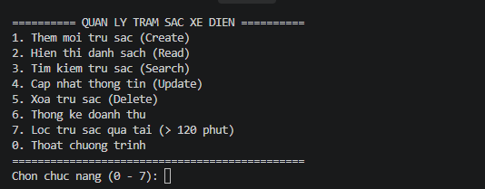
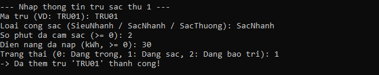
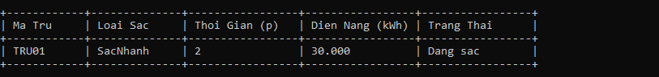

# Hệ Thống Quản Lý Trạm Sạc Xe Điện (EV Charging Station)

Ứng dụng giao diện dòng lệnh (Console) viết bằng ngôn ngữ C giúp quản lý danh sách các trụ sạc xe điện trong bộ nhớ tạm (RAM).

## 1. Thành viên nhóm & Phân công công việc

| Thành viên | Vai trò & Nhiệm vụ |
| :--- | :--- |
| **Phan Thị Phương Mai** | Khảo sát yêu cầu, thiết kế cấu trúc dữ liệu (`struct TramSac`), xây dựng kịch bản Menu điều hướng, kiểm thử và biên soạn tài liệu báo cáo (`README.md`). |
| **Hồ Đặng Đăng Dương** | Thiết lập và quản lý kho lưu trữ GitHub, hiện thực hóa mã nguồn ngôn ngữ C (`main.c`), xây dựng bộ hàm kiểm tra dữ liệu đầu vào (Validate) và các chức năng xử lý. |

## 2. Cấu trúc dữ liệu (`struct TramSac`)

Mỗi trụ sạc được lưu trữ trong mảng tĩnh tối đa `100` phần tử với 5 thuộc tính:
- `maTru` (`char[10]`): Mã định danh trụ sạc (Khóa chính, bắt đầu bằng `"TRU"` và theo sau là các chữ số, ví dụ: `"TRU01"`).
- `loaiSac` (`char[20]`): Loại cổng sạc (`"SieuNhanh"`, `"SacNhanh"`, `"SacThuong"`).
- `thoiGianSac` (`int`): Số phút xe đã cắm sạc tại trụ (`>= 0`).
- `dienNangDaSac` (`float`): Điện năng đã nạp vào xe tính theo kWh (`>= 0.0`, hiển thị 3 chữ số thập phân `.3f`).
- `trangThai` (`int`): Trạng thái hoạt động (`0`: Đang trống, `1`: Đang sạc, `2`: Đang bảo trì).

## 3. Các chức năng chính

1. **Thêm mới trụ sạc (Create)**: Nhập một hoặc nhiều trụ sạc mới, kiểm tra định dạng và trùng mã. *(Hoàn thành Tuần 1)*
2. **Hiển thị danh sách (Read)**: In bảng danh sách trụ sạc căn chỉnh cột. *(Hoàn thành Tuần 1)*
3. **Tìm kiếm trụ sạc (Search)**: Tìm theo `maTru` hoặc lọc theo `loaiSac`. *(Tuần 2)*
4. **Cập nhật thông tin (Update)**: Cập nhật trạng thái hoặc điện năng theo `maTru`. *(Tuần 2)*
5. **Xóa trụ sạc (Delete)**: Xóa trụ sạc khỏi mảng theo `maTru`. *(Tuần 2)*
6. **Thống kê doanh thu**: Tính tổng điện năng tiêu thụ và doanh thu (đơn giá `3.858 VND/kWh`). *(Tuần 2)*
7. **Lọc trụ sạc quá tải (Mở rộng)**: Hiển thị các trụ cắm sạc liên tục trên 120 phút. *(Tuần 2)*

## 4. Hướng dẫn biên dịch và chạy chương trình

Sử dụng trình biên dịch `gcc` trên Terminal / Command Prompt:

```bash
gcc main.c -o tram_sac
./tram_sac
```

Trên Windows (CMD / PowerShell):

```cmd
gcc main.c -o tram_sac.exe
tram_sac.exe
```

## 5. Ảnh chụp màn hình Demo (Screenshot)






